# DSH-RAG

English | [简体中文](./README.zh.md)

[](https://beancookie.github.io/awesome-dsh-plugin) [](https://dshfind.com/en/plugins/imkelt/DSH-RAG?ref=badge)

<p align="center">
  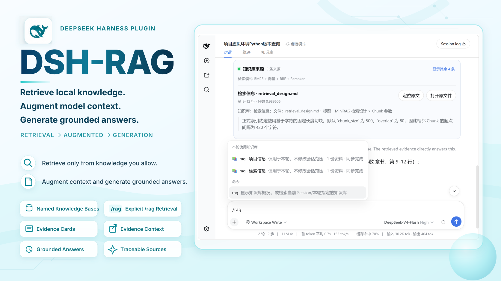
</p>

DSH-RAG is a local knowledge-base plugin for **DeepSeek Harness Web**. It turns explicitly authorized local folders into named, incrementally synchronized knowledge bases. When you run `/rag <question>`, retrieval completes before the model answers and the UI shows verifiable evidence with excerpts, exact source locations, and open-file actions.

> Regular chat never accesses local documents. Retrieval runs only for explicit `/rag` turns, using either the knowledge bases selected for the current Session or a one-turn `@knowledge-base` override.

## Highlights

- **Named knowledge bases** — Build reusable knowledge bases from one or more explicitly authorized local folders and use them across projects and Sessions.
- **Explicit `/rag` retrieval** — Retrieval completes before the model answers instead of depending on the model to decide whether to call a tool.
- **Session-scoped search** — Search only the knowledge bases selected for the current Session, with optional `@knowledge-base` selectors for one-turn overrides.
- **Verifiable evidence** — Source cards show the knowledge base, file, structural context, excerpt, and exact page, slide, paragraph, or line reference.
- **Hybrid retrieval with offline fallback** — Local multilingual BM25 works without an API key or network; SiliconFlow can add embeddings, local vectors, RRF, and reranking.
- **Local-document support** — Parse PDF, DOCX, PPTX, Markdown, and UTF-8 text with incremental indexing, cancellation, file-level checkpoints, watcher debouncing, and recovery scans.
- **Bilingual, theme-aware UI** — Follow the DeepSeek Harness language setting and light, dark, or system appearance.

## Requirements

- Node.js `^22.19.0` or `>=24.0.0`
- pnpm available on `PATH` (`dsh plugin` uses pnpm to manage profile packages)
- DeepSeek Harness: tested with `0.1.1-rc.2`

> DeepSeek Harness is currently a developer preview. `0.1.1-rc.2` is the version DSH-RAG has verified through package installation, startup, and removal checks; it does not mean the plugin can run only on that version. Other DSH versions may work, but are not claimed as compatible until they pass the same checks.

## Quick Start

### 1. Install and start

If you have not installed the `dsh` command, the simplest option is to run DSH through npx:

```powershell
npx @deepseek-ai/dsh plugin --profile web add @kai232/dsh-rag
npx @deepseek-ai/dsh web
```

Keep the second command running, then open the Web address printed in the terminal.

#### If `dsh` is already installed

If `dsh --version` works in your terminal:

```powershell
dsh plugin --profile web add @kai232/dsh-rag
dsh web
```


#### Run from the DeepSeek Harness source repository

```powershell
git clone https://github.com/deepseek-ai/deepseek-harness.git
cd deepseek-harness
pnpm install
pnpm run build
pnpm dsh plugin --profile web add @kai232/dsh-rag
pnpm dsh web
```

If you already have a local checkout, skip `git clone`, enter its root directory, and continue with `pnpm install`. The `pnpm run build` step prepares the source artifacts used by `pnpm dsh web`.


To update DSH-RAG, stop the running Web process, repeat the corresponding `plugin add` command, and start Web again.

### 2. Create and sync a knowledge base

Open **Settings → Knowledge**. SiliconFlow is optional: configure the Endpoint, Embedding model, Reranker model, and API key when you want hybrid retrieval. Without an API key or network, local BM25 retrieval still works.

The API key is stored in the operating-system credential vault. If the vault is unavailable, set `SILICONFLOW_API_KEY` before starting DSH; the plugin never falls back to a plaintext key file. Connection status is checked automatically, and **Retry** appears only after a failure.

#### Configure retrieval models

<p align="center">
  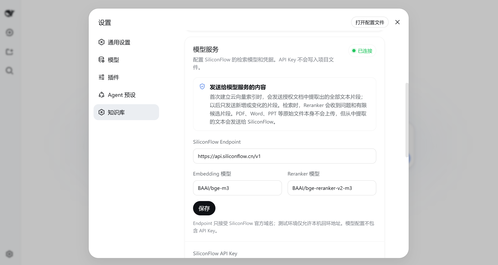
</p>

<p align="center">
  <sub>Optional: configure model services for vector retrieval and reranking.</sub>
</p>

#### Create and sync a knowledge base

<p align="center">
  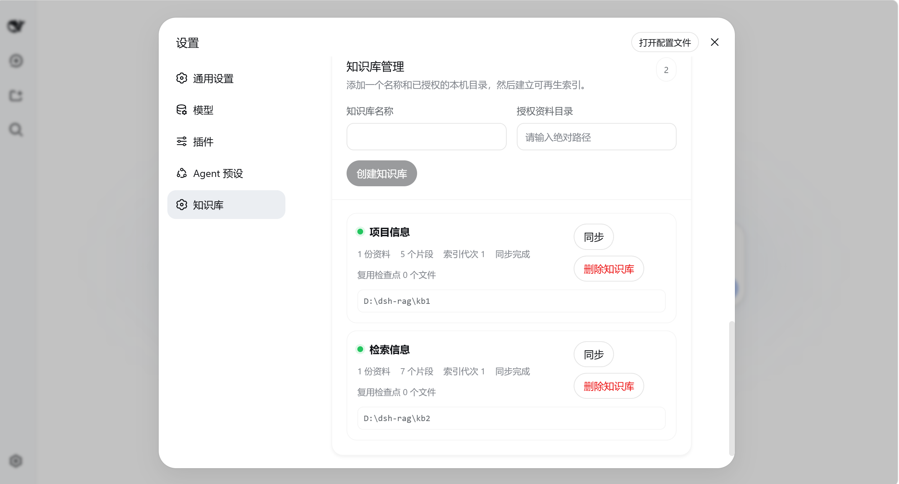
</p>

<p align="center">
  <sub>Create a knowledge base from explicitly authorized local folders, then sync it.</sub>
</p>

Knowledge-base names and file names are user data and are not translated when the interface language changes.

### 3. Choose the Session retrieval scope

In the conversation **Knowledge** panel, select the knowledge bases the current Session may search. The selection becomes the saved default retrieval scope for that Session; selecting a knowledge base does not trigger automatic retrieval.

<p align="center">
  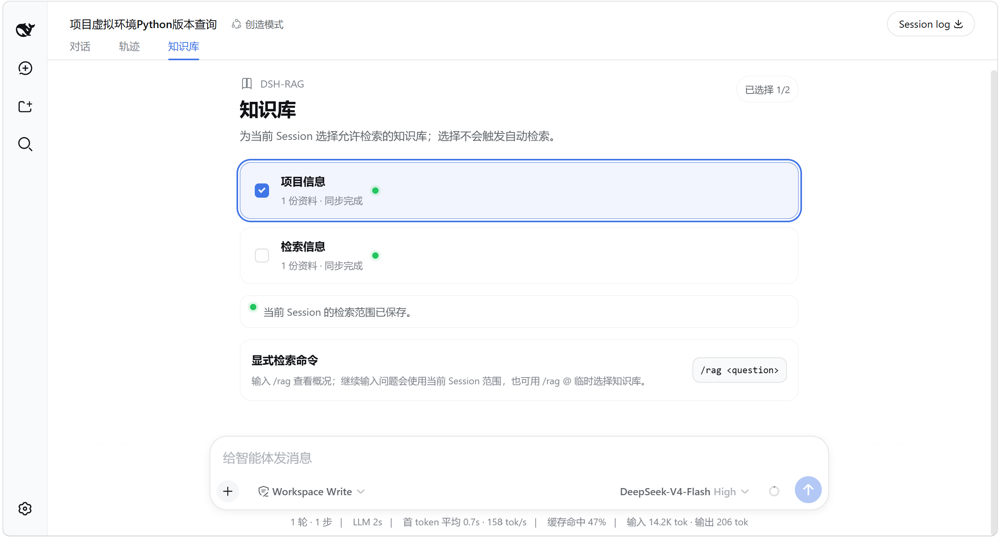
</p>

### 4. Use `/rag`

Basic command:

```text
/rag <question>
```

Use the scope saved for the current Session:

```text
/rag What does the project note say about the launch window?
```

Typing `/rag` shows the base command and one-turn variants for each knowledge base in the first menu. After entering the command, `/rag @` also places knowledge bases above the general file, folder, and Session candidates; choosing one inserts a plain-text selector.

#### Type `/rag`

<p align="center">
  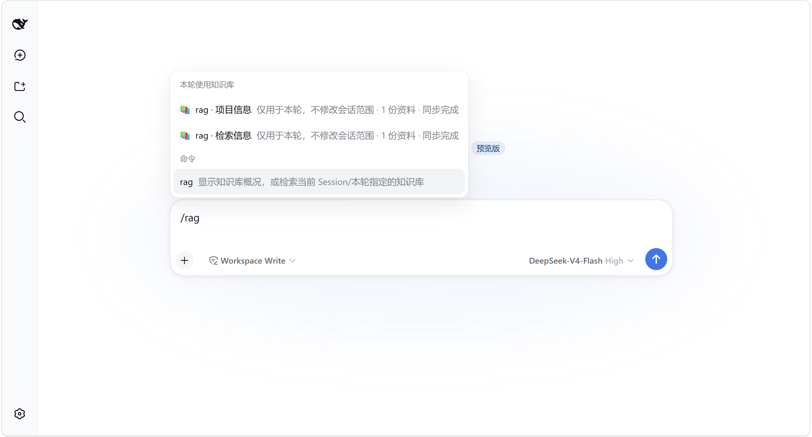
</p>

<p align="center">
  <sub>Type <code>/rag</code> to see the command and one-turn knowledge-base variants.</sub>
</p>

#### Type `/rag @`

<p align="center">
  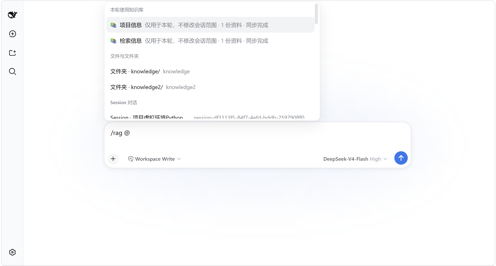
</p>

<p align="center">
  <sub>Type <code>/rag @</code> to choose a temporary retrieval scope.</sub>
</p>

To override the scope for a single turn, select a knowledge base:

```text
/rag @"Project notes" Which Python version does the virtual environment use?
```

Names without whitespace use the shorter form, such as `/rag @Notes <question>`. The one-turn override does not change the Session's saved selection.

<p align="center">
  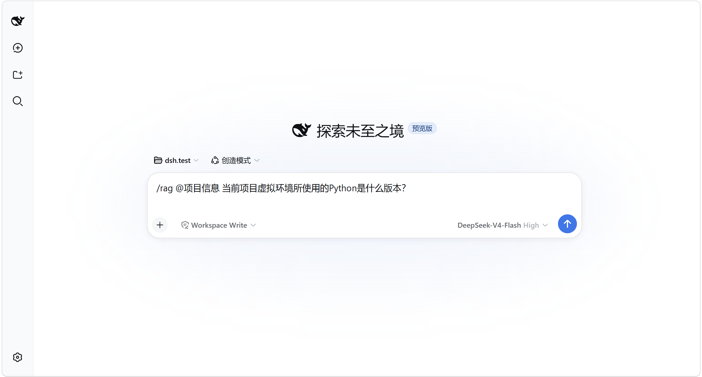
</p>

Running `/rag` alone shows knowledge-base statistics and usage without calling the model. If no knowledge base is selected, the plugin stops with guidance instead of searching every knowledge base.

<p align="center">
  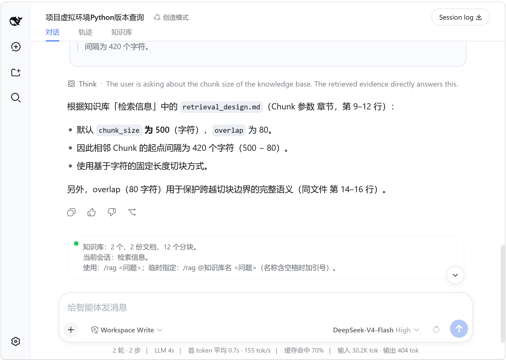
</p>

## Inspect the Evidence

For a `/rag` turn, DSH-RAG **completes retrieval first and only then passes the evidence to the model**. Retrieval therefore does not depend on whether the model decides to call a tool.

Each source card identifies the knowledge base, file, structural context, excerpt, and exact source location. The open action sends only an opaque source ID; the Host resolves and validates the path again before asking the operating system to open it.

<p align="center">
  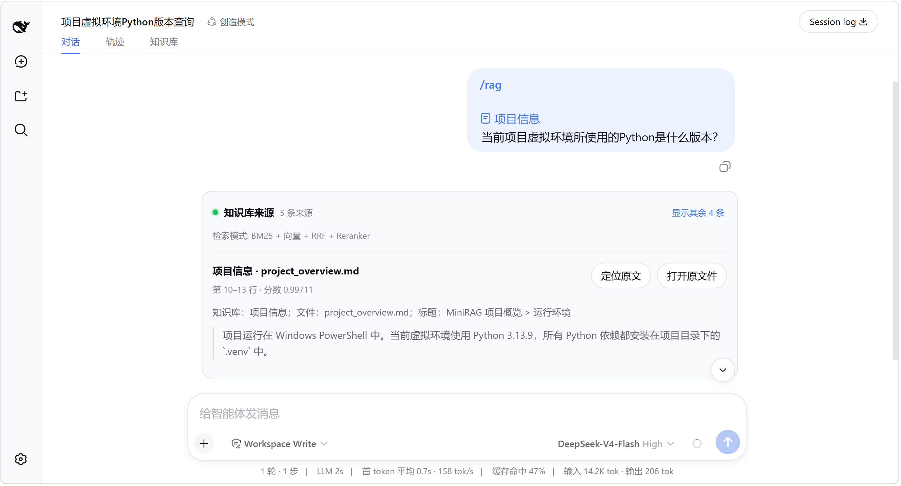
</p>

<p align="center"><sub>Each result exposes the knowledge base, file, exact location, score, and the excerpt used as evidence.</sub></p>

Use **Locate in source** or **Open file** to return to the original document and verify the surrounding context:

<p align="center">
  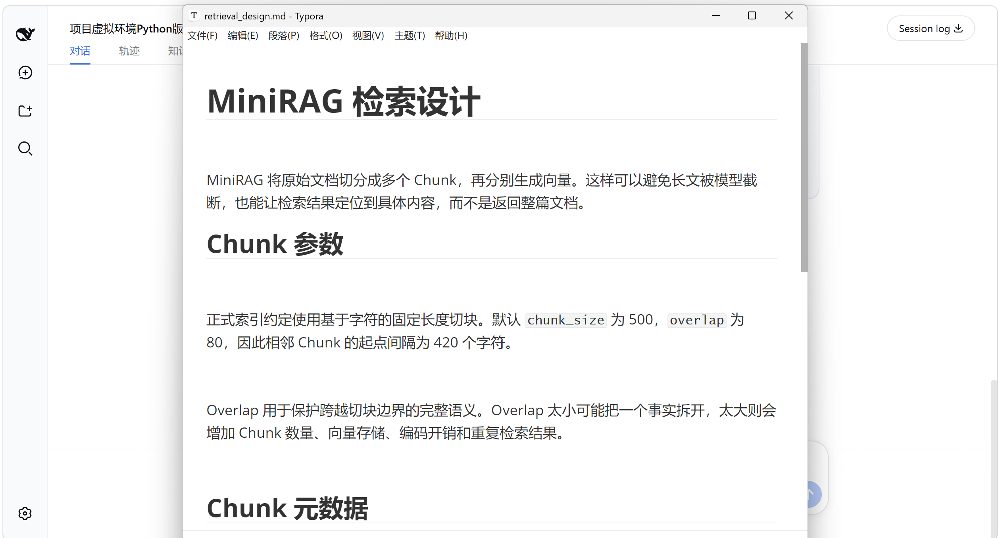
</p>

### More screenshots: switch the Session scope and retrieve again

<p align="center">
  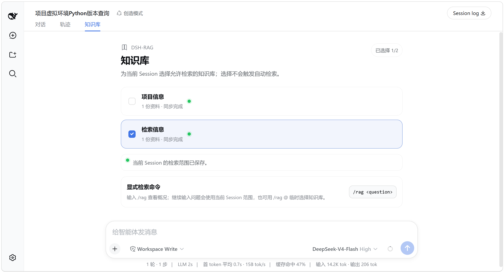
</p>

<p align="center">
  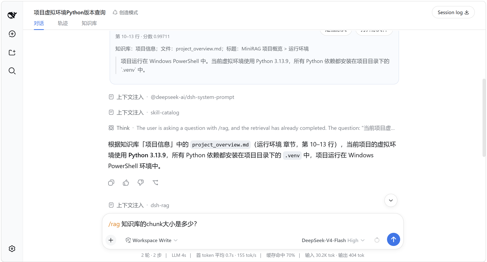
</p>

<p align="center">
  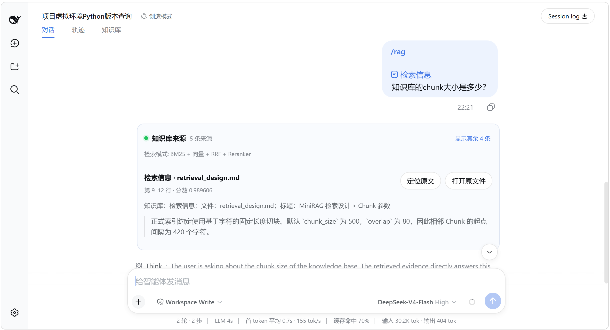
</p>

<p align="center">
  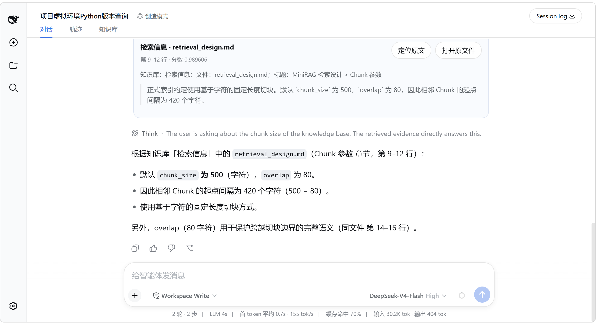
</p>


## Retrieval Flow

The explicit retrieval path is:

```text
/rag
  ↓
Resolve saved Session scope / one-turn @knowledge-base override
  ↓
Local BM25
  ↓
[With SiliconFlow configured: Embedding → local vectors → RRF → Reranker]
  ↓
Build verifiable source cards
  ↓
Pass retrieved evidence to the model
```

Regular messages bypass this path and never search or inject local documents.

## Retrieval and Offline Behavior

With SiliconFlow configured, the first cloud vector index sends every text chunk extracted from the authorized documents. Later syncs send only new or changed chunks for Embedding. Each explicit query sends the query and a limited candidate set for Reranking. Original PDF, Word, or PowerPoint files are not uploaded, but their extracted text is sent to SiliconFlow.

If SiliconFlow or the network is unavailable, DSH-RAG reports the fallback and continues with local BM25. Existing local indexes remain available. The v0.1 release does not expose AI-generated document or section context because that experiment did not improve the frozen retrieval evaluation.

## Local Data and Deletion

Derived data is stored under `$DSH_HOME/dsh-rag/` by default, independent of the directory where DSH is started. **Settings → Knowledge → Data location** shows and opens the actual folder. Set `DSH_RAG_DATA_DIR` to an absolute path before starting DSH only when you need a custom location.

When the default location is empty and legacy data exists in the old launch-directory `.dsh-rag` folder, the plugin copies, validates, and promotes it without deleting the old folder. If both locations contain data, it leaves both unchanged and reports the conflict instead of merging automatically.

The **Delete knowledge base** action uses a second confirmation and removes only the knowledge-base settings and reproducible catalogs, checkpoints, and indexes. It never modifies or deletes files in the authorized source folders.

To back up derived data, stop DSH and copy the complete data directory. Indexes are reproducible and can be rebuilt from the original folders.

## Security and Privacy

- Authorized paths are normalized and checked with `realpath`; symbolic-link, junction, UNC, and path-escape cases are rejected.
- Hidden files, common credential files, executables, active Office content, embedded objects, and unsafe archive expansion are excluded.
- Document text is treated as untrusted data, never as an Agent instruction.
- API keys are not written to project settings, logs, Sessions, browser storage, indexes, or API responses.
- Persistent keys use Windows Credential Manager, macOS Keychain, or Linux Secret Service. There is no plaintext credential-file fallback.

## License

MIT
