# DSH-RAG

[English](./README.md) | 简体中文

[](https://beancookie.github.io/awesome-dsh-plugin) [](https://dshfind.com/en/plugins/imkelt/DSH-RAG?ref=badge)

<p align="center">
  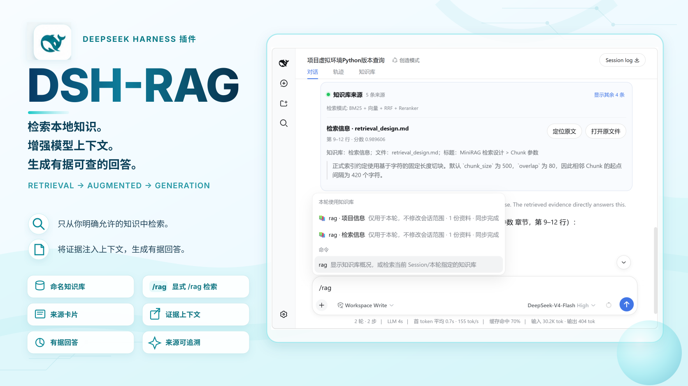
</p>


DSH-RAG 是面向 **DeepSeek Harness Web** 的本地知识库插件。它把用户明确授权的本机目录建立为可增量同步的命名知识库；执行 `/rag <问题>` 时，插件会在模型回答前完成检索，并展示带原文片段、精确位置和原文件打开入口的可核查来源。

> 普通对话不会访问本地资料。只有显式执行 `/rag` 时才会检索当前 Session 允许使用的知识库，或本轮通过 `@知识库` 临时指定的范围。

## 亮点

- **命名知识库**：将一个或多个明确授权的本机目录建立为多个可复用知识库，并可跨项目、跨 Session 使用。
- **显式 `/rag` 检索**：检索先于模型回答执行，不依赖模型自行决定是否调用工具。
- **Session 范围控制**：只搜索当前 Session 已选择的知识库，也可以用 `@知识库` 临时覆盖本轮范围。
- **可核查来源**：来源卡片展示知识库、文件、结构上下文、原文片段，以及精确页码、幻灯片、段落或行号。
- **混合检索与离线降级**：本地中英文 BM25 无需 API Key 或网络即可工作；配置 SiliconFlow 后可启用 Embedding、本地向量、RRF 和 Reranker。
- **本地文件友好**：支持 PDF、DOCX、PPTX、Markdown 和 UTF-8 文本，并提供增量索引、取消、文件级检查点、watcher 防抖和补偿扫描。
- **双语与主题适配**：界面跟随 DeepSeek Harness 的中英文语言设置，并适配浅色、深色和系统外观。

## 环境要求

- Node.js `^22.19.0` 或 `>=24.0.0`
- `PATH` 中可以使用 pnpm（`dsh plugin` 通过 pnpm 管理 Profile 中的包）
- DeepSeek Harness：已验证版本为 `0.1.1-rc.2`

> DeepSeek Harness 目前仍处于开发者预览期。`0.1.1-rc.2` 是 DSH-RAG 已实际通过安装、启动和卸载检查的版本，并不表示插件只能在该版本运行；其他 DSH 版本可能可用，但通过同样的兼容性检查前不作保证。

## 快速开始

### 1. 安装并启动

如果尚未安装 `dsh` 命令，推荐直接通过 npx 使用：

```powershell
npx @deepseek-ai/dsh plugin --profile web add @kai232/dsh-rag
npx @deepseek-ai/dsh web
```

保持第二条命令运行，然后打开终端中显示的 Web 地址。

#### 已经安装 `dsh`

如果 `dsh --version` 能正常显示版本，可直接执行：

```powershell
dsh plugin --profile web add @kai232/dsh-rag
dsh web
```


#### 从 DeepSeek Harness 源码运行

```powershell
git clone https://github.com/deepseek-ai/deepseek-harness.git
cd deepseek-harness
pnpm install
pnpm run build
pnpm dsh plugin --profile web add @kai232/dsh-rag
pnpm dsh web
```

如果本机已经有该源码仓库，可以跳过 `git clone`，进入仓库根目录后从 `pnpm install` 继续。`pnpm run build` 会准备 `pnpm dsh web` 运行所需的源码产物。


更新 DSH-RAG 时，先停止正在运行的 Web 进程，重新执行对应方式中的 `plugin add` 命令，然后再次启动 Web。

### 2. 创建并同步知识库

打开 **设置 → 知识库**。如果需要混合检索，可配置 SiliconFlow Endpoint、Embedding 模型、Reranker 模型和 API Key；如果没有 API Key 或网络，本地 BM25 仍然可以检索。

API Key 会保存到操作系统凭据库。如果系统凭据库不可用，可在启动 DSH 前设置 `SILICONFLOW_API_KEY`；插件不会回退到明文 Key 文件。连接状态会自动检测，只有失败后才显示 **重试**。

#### 配置检索模型

<p align="center">
  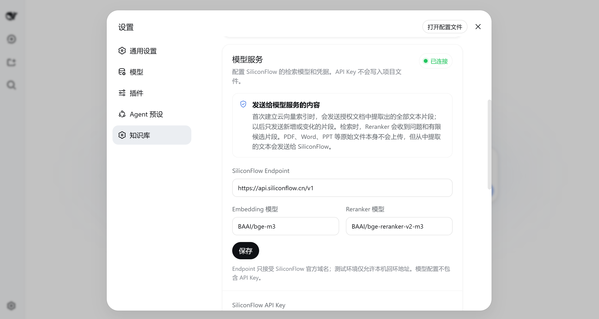
</p>

<p align="center">
  <sub>可选：配置用于向量检索和重排序的模型服务。</sub>
</p>

#### 创建并同步知识库

<p align="center">
  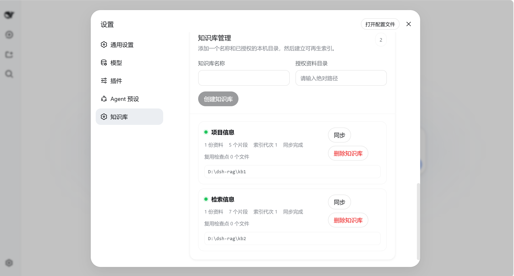
</p>

<p align="center">
  <sub>创建知识库，只填写你明确授权的本机目录，然后执行同步。</sub>
</p>

知识库名称和文件名属于用户数据，切换界面语言时不会被翻译。

### 3. 为当前 Session 选择检索范围

在会话的 **知识库** 面板中勾选当前 Session 允许检索的知识库。这个选择会保存为当前 Session 的默认检索范围；选择知识库本身不会触发自动检索。

<p align="center">
  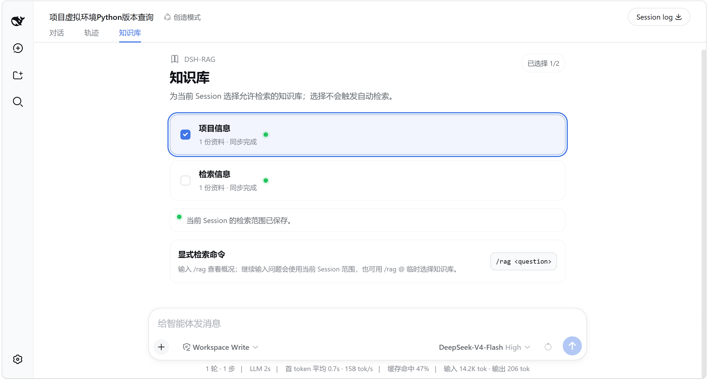
</p>

### 4. 使用 `/rag`

基本命令：

```text
/rag <问题>
```

使用当前 Session 已保存的范围：

```text
/rag 项目记录中的发布时间窗口是什么？
```

输入 `/rag` 时，第一次命令菜单会同时显示标准命令和各知识库的本轮命令变体。进入命令后输入 `/rag @`，知识库会排在通用文件、文件夹和 Session 候选之前；选择后插入普通文本参数。

#### 输入 `/rag`

<p align="center">
  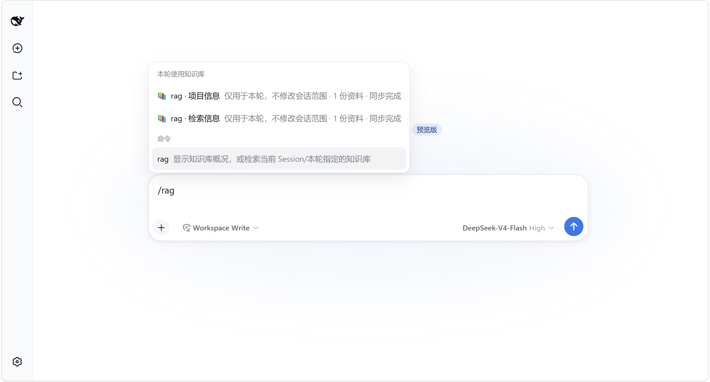
</p>

<p align="center">
  <sub>输入 <code>/rag</code> 查看命令和本轮知识库候选。</sub>
</p>

#### 输入 `/rag @`

<p align="center">
  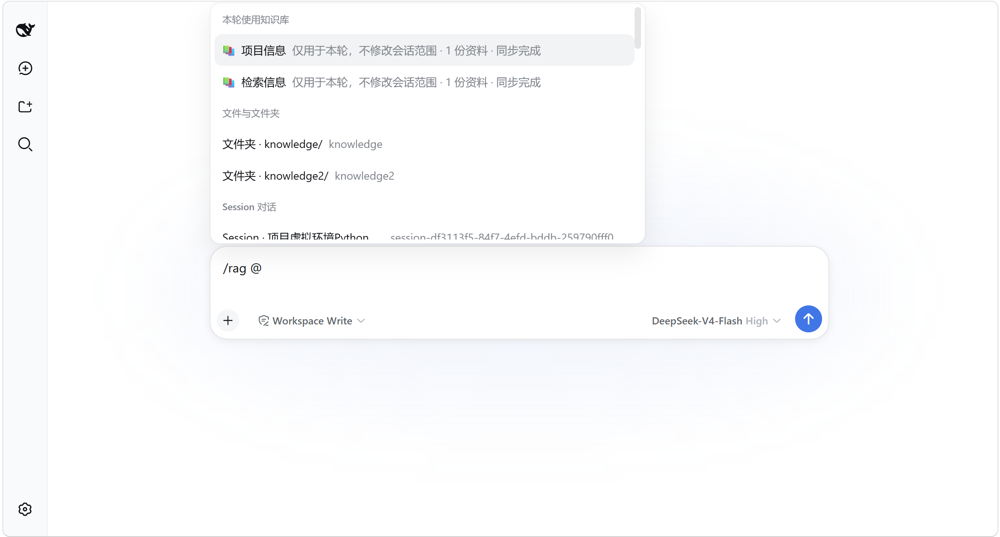
</p>

<p align="center">
  <sub>输入 <code>/rag @</code> 临时选择本轮检索范围。</sub>
</p>

需要临时覆盖本轮范围时，可以选择一个知识库：

```text
/rag @项目信息 当前项目虚拟环境使用的 Python 版本是什么？
```

名称不含空格时使用简洁的 `@知识库名`；名称含空格等特殊字符时自动使用 `@"知识库名"`。本轮覆盖不会修改当前 Session 已保存的选择。

<p align="center">
  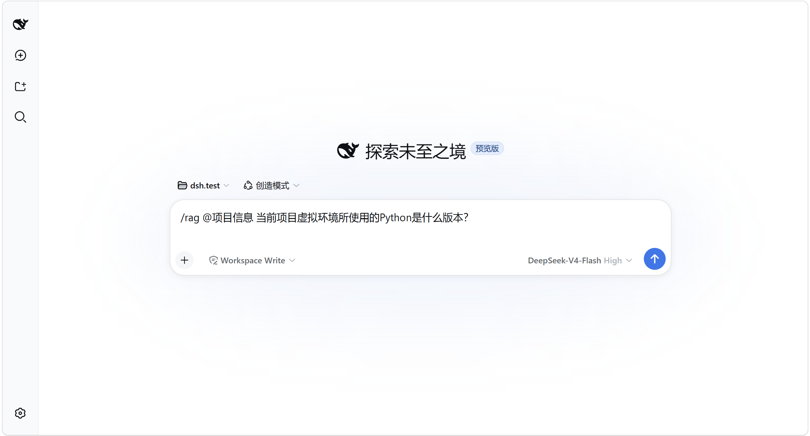
</p>

单独执行 `/rag` 只显示知识库统计和用法，不调用模型。没有选择知识库时，插件会提示先选择，不会自动搜索全部知识库。

<p align="center">
  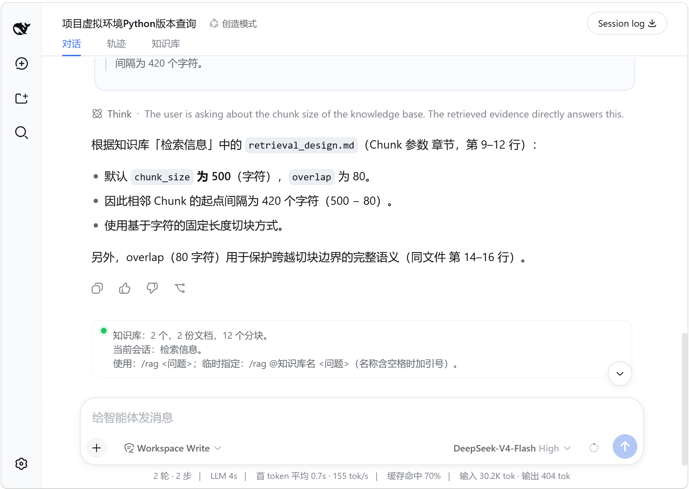
</p>

## 查看检索来源

发送 `/rag` 后，插件会**先真正完成检索，再把来源证据交给模型回答**。因此检索过程不会依赖模型是否主动调用工具。

来源卡片会显示知识库、文件名、结构上下文、原文片段和精确位置。打开原文件时，界面只提交不透明的来源 ID，Host 会重新解析并验证路径，再交给操作系统打开。

<p align="center">
  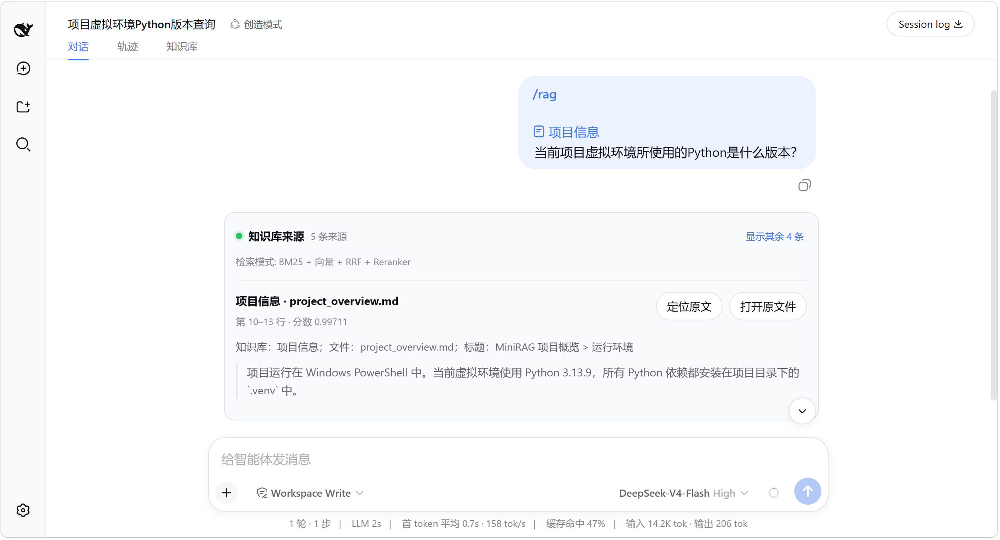
</p>

<p align="center"><sub>每条来源都可以核对所属知识库、文件、位置、分数和实际用于回答的原文片段。</sub></p>

点击 **定位原文** 或 **打开原文件** 可以回到真实文档核查上下文：

<p align="center">
  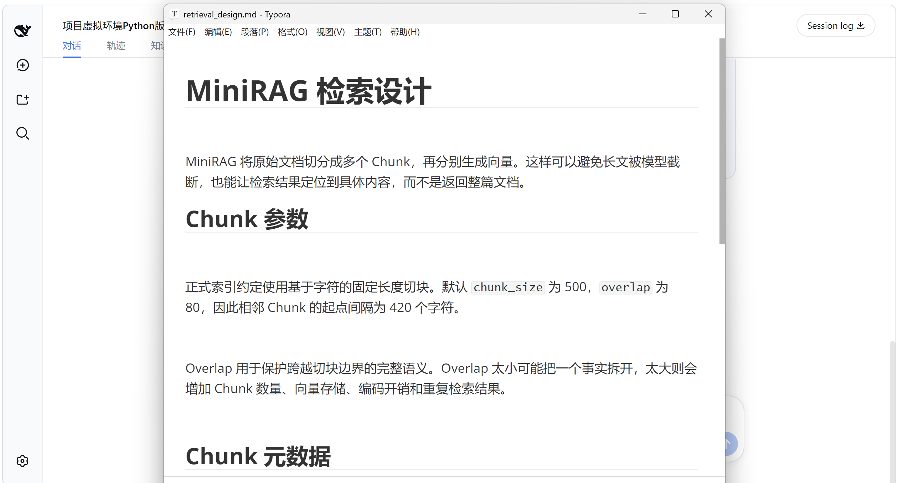
</p>

### 更多示例：切换 Session 范围后再次检索

<p align="center">
  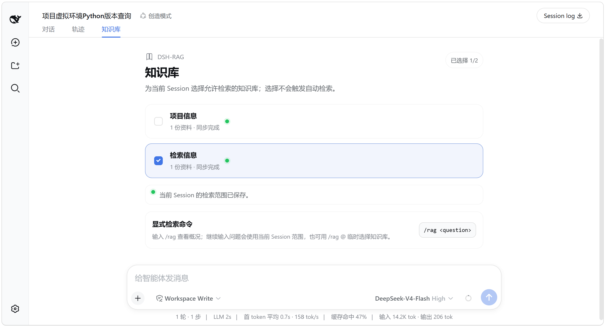
</p>

<p align="center">
  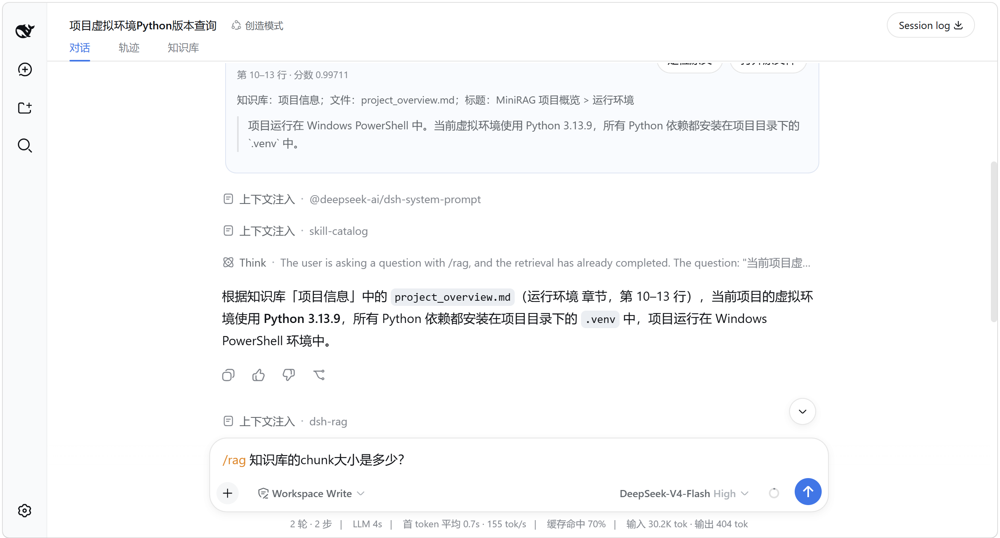
</p>

<p align="center">
  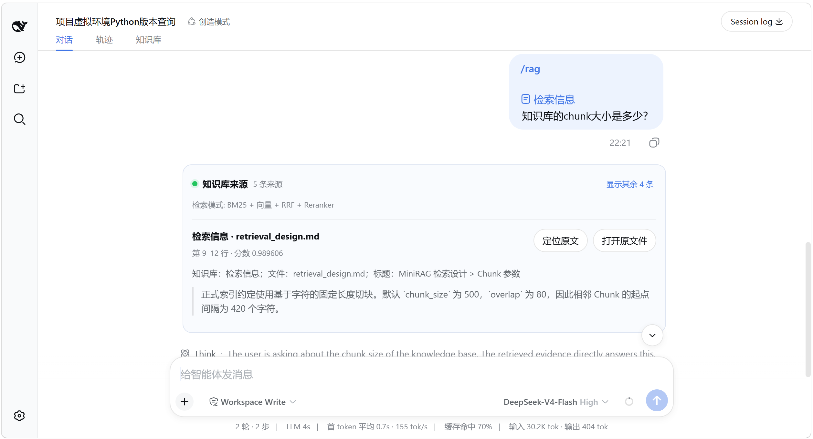
</p>

<p align="center">
  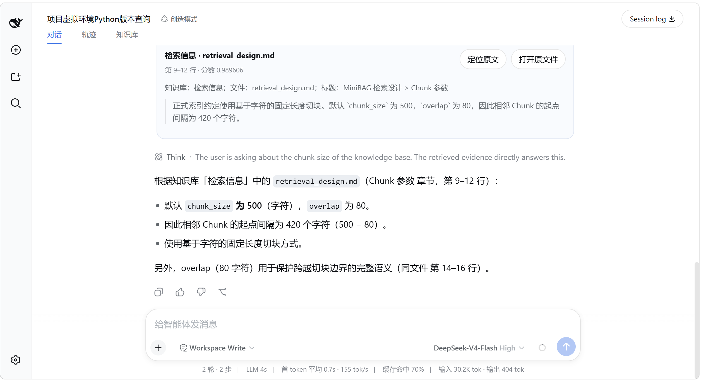
</p>


## 检索流程

DSH-RAG 的显式检索流程可以概括为：

```text
/rag
  ↓
解析当前 Session 范围 / 本轮 @知识库
  ↓
本地 BM25
  ↓
[配置 SiliconFlow 时：Embedding → 本地向量 → RRF → Reranker]
  ↓
生成可核查的来源卡片
  ↓
把检索证据交给模型回答
```

普通消息不会经过这条流程，也不会搜索或注入本地资料。

## 检索与离线降级

配置 SiliconFlow 后，首次建立云向量索引会发送授权文档中提取出的全部文本片段；后续同步只为新增或变化片段请求 Embedding。显式查询时只向 Reranker 发送查询和有限候选。PDF、Word、PPT 等原始文件本身不会上传，但从中提取的文本会发送给 SiliconFlow。

SiliconFlow 或网络不可用时，界面会明确显示降级，并继续使用本地 BM25；已有本地索引仍可检索。AI 生成的文档或章节背景没有提高冻结评测指标，因此 v0.1 不提供该能力。

## 本机数据与删除

派生数据默认保存在 `$DSH_HOME/dsh-rag/`，不会随 DSH 的启动目录改变。实际位置可在 **设置 → 知识库 → 数据位置** 中查看并打开。只有需要自定义位置时，才应在启动 DSH 前将 `DSH_RAG_DATA_DIR` 设置为绝对路径。

如果默认位置为空，而旧启动目录中存在 `.dsh-rag` 数据，插件会复制、校验并原子迁入新位置，同时保留旧目录；如果新旧位置都有数据，则保持两边不变并提示冲突，不会自动混合。

设置页的 **删除知识库** 需要二次确认，只删除知识库配置和可再生的 catalog、检查点与索引，绝不会修改或删除授权目录中的原始资料。

备份派生数据时，应先停止 DSH，再复制整个数据目录。索引可以根据原始目录重新建立。

## 安全与隐私

- 授权路径经过规范化和 `realpath` 复核，拒绝符号链接、junction、UNC 和路径逃逸。
- 默认排除隐藏文件、常见凭据文件、可执行文件、Office 活动内容、嵌入对象和危险压缩展开。
- 文档文本始终是不可信数据，不会作为 Agent 指令执行。
- API Key 不会写入项目设置、日志、Session、浏览器存储、索引或 API 响应。
- 持久 Key 使用 Windows Credential Manager、macOS Keychain 或 Linux Secret Service，不提供明文凭据文件回退。

## License

MIT
